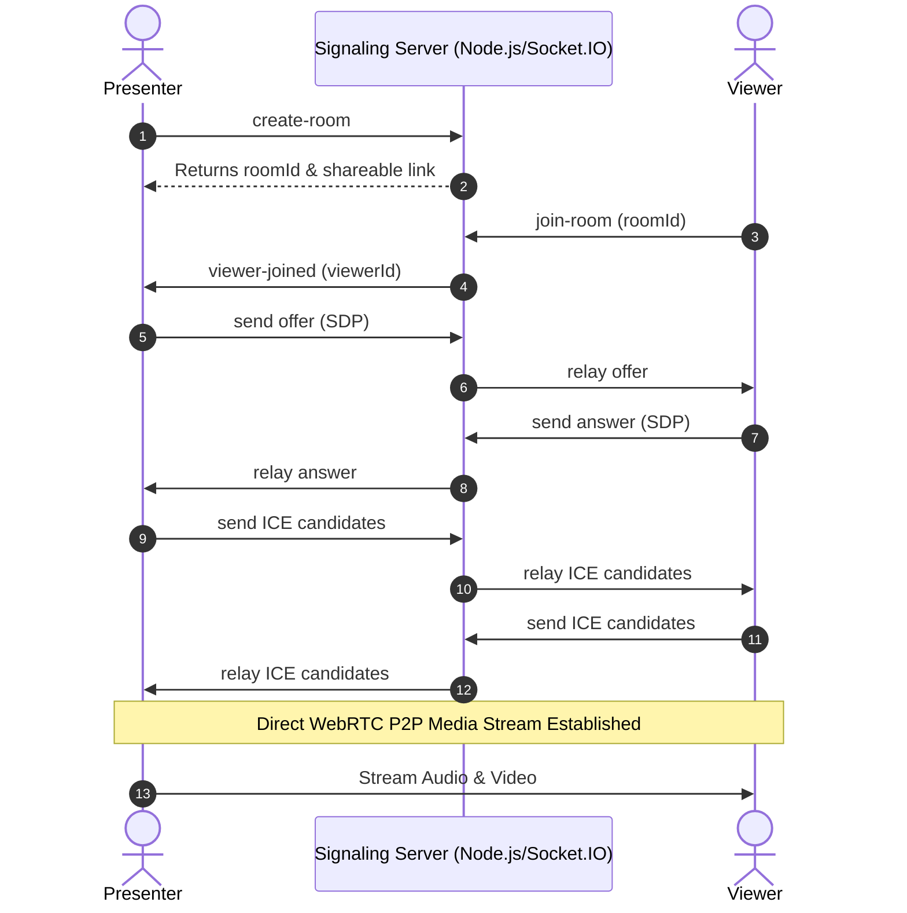

# 🖥️ WebRTC Screen Share

A real-time, peer-to-peer screen sharing web application built with **Node.js**, **Express**, **Socket.IO**, and **WebRTC**. Presenters can capture their screen/tabs/windows with audio and share a link with viewers for low-latency live streaming.

---

## ✨ Features

- **⚡ Low-Latency Streaming:** Peer-to-peer WebRTC streaming with minimal lag.
- **🔗 Instant Shareable Links:** Generate unique, short room URLs (e.g. `/view/:roomId`) in one click.
- **👥 Multi-Viewer Support:** Multiple viewers can connect to the same stream simultaneously.
- **🔊 Audio & Video Sharing:** Supports tab audio capture along with screen video.
- **🎙️ Real-Time Voice:** Open the link and you're in the call. The browser asks for microphone access once, then everyone in the room can talk to each other directly. Mute or unmute with the mic button or the **`M`** key. If you block the mic you can still listen and chat.
- **💬 Live Chat:** Text chat for the whole room, with a downloadable transcript.
- **📱 Responsive UI:** Dark-mode glassmorphic UI optimized for desktop and mobile viewing.
- **🛡️ Secure Signaling:** Socket.IO signaling with fallback support and graceful disconnect handling.
- **☁️ Cloud & Container Ready:** Out-of-the-box support for **Render**, **Docker**, and **Kubernetes**.

---

## 🏗️ Architecture



---

## 🎙️ How Voice Works

```
        Host
       ╱    ╲          screen share: Host ──▶ each viewer (one-way)
  Viewer A ── Viewer B  voice:        every pair connected (two-way, audio only)
```

- **Join automatically:** when the host starts sharing, or a viewer opens the link, the page asks for the microphone right away. Allow it and you're live. Block it and you join as a listener; the button shows **🚫 Mic Blocked** and you can click it to try again after allowing the mic in the browser's site settings.
- **Mute / unmute:** click the mic button (bottom-left) or press **`M`**. Typing "m" in chat doesn't count. Muting switches the mic off without releasing it, so unmuting is instant and never asks for permission again.
- **Separate from the screen share:** voice uses its own audio-only connections (`public/js/voice.js`), one between every pair of participants (a mesh). The screen stream doesn't change.
- **Group size:** each person sends their audio to everyone else, so it works best for up to about 8 people.
- **Mobile:** iOS Safari may need one tap on the page before other people's audio starts playing. Any tap is enough.

> [!TIP]
> If some people can see the screen but can't connect (strict corporate or mobile networks), set up a **TURN server**. See the **Environment Variables** section below.

---

## 🚀 Quick Start (Local Development)

### Prerequisites

- [Node.js](https://nodejs.org/) (v18 or higher recommended)
- `npm` (bundled with Node.js)

### Installation

1. **Clone the repository:**
   ```bash
   git clone https://github.com/<your-username>/<your-repo-name>.git
   cd <your-repo-name>
   ```

2. **Install dependencies:**
   ```bash
   npm install
   ```

3. **Start the server:**
   ```bash
   npm start
   ```

4. **Open in browser:**
   - Presenter: [http://localhost:3000](http://localhost:3000)
   - Click **"Start Sharing"** to create a room and copy the viewer link.

---

## 🌐 Deploy to Render

This repository includes a [`render.yaml`](./render.yaml) blueprint for 1-click or automated deployment.

### Option 1: Automatic Blueprint (Recommended)
1. Push this repository to GitHub/GitLab.
2. Go to [Render Dashboard](https://dashboard.render.com/) → **New +** → **Blueprint**.
3. Connect your repository — Render will automatically configure the Web Service and health checks.

### Option 2: Manual Web Service Setup
1. Go to [Render Dashboard](https://dashboard.render.com/) → **New +** → **Web Service**.
2. Connect your Git repository.
3. Configure the following:
   - **Environment:** `Node`
   - **Build Command:** `npm install`
   - **Start Command:** `npm start`
   - **Health Check Path:** `/health`
   - **Instance Type:** `Free` or `Starter`
4. Click **Create Web Service**.

> [!IMPORTANT]
> WebRTC screen capture (`navigator.mediaDevices.getDisplayMedia`) and microphone access (`getUserMedia`) require an **HTTPS** context. Render automatically provisions free SSL certificates for your custom or `*.onrender.com` domain.

---

## 🐳 Docker Deployment

You can also run the application as a Docker container:

```bash
# Build the Docker image
docker build -t webrtc-screen-share .

# Run the container on port 3000
docker run -d -p 3000:3000 --name webrtc-app webrtc-screen-share
```

Access the app at `http://localhost:3000`.

---

## 📁 Project Structure

```
├── public/
│   ├── css/
│   │   └── style.css         # Modern dark-theme styling
│   ├── js/
│   │   ├── presenter.js      # Screen capture & presenter WebRTC logic
│   │   ├── voice.js          # Group voice mesh (mic toggle, shared by both pages)
│   │   └── viewer.js         # Viewer stream receiver & controls
│   ├── index.html            # Presenter dashboard
│   └── view.html             # Viewer page
├── Dockerfile                # Multi-stage production container
├── k8s-deployment.yaml       # Kubernetes Deployment & Service manifests
├── render.yaml               # Render Infrastructure-as-Code Blueprint
├── server.js                 # Express server & Socket.IO signaling relay
├── package.json              # Project metadata & dependencies
└── README.md                 # Documentation
```

---

## ⚙️ Environment Variables

| Variable | Default | Description |
| :--- | :--- | :--- |
| `PORT` | `3000` | Port on which the HTTP & WebSocket server listens. |
| `NODE_ENV` | `development` | Set to `production` in deployed environments. |
| `TURN_URLS` | _(empty)_ | Optional. Comma-separated TURN server URLs, e.g. `turn:turn.example.com:3478,turns:turn.example.com:5349`. Used for both screen share and voice when a direct connection isn't possible. |
| `TURN_USERNAME` | _(empty)_ | Username for the TURN servers above. |
| `TURN_CREDENTIAL` | _(empty)_ | Password/credential for the TURN servers above. |

> [!NOTE]
> TURN credentials are sent to every browser that opens the app (via `/api/ice-servers`), because the browser needs them to connect. Use credentials from a provider that rate-limits or expires them (e.g. Cloudflare Calls TURN, Twilio, Metered, or your own [coturn](https://github.com/coturn/coturn)). Without these variables, the app uses public STUN servers only.

---

## 📄 License

This project is licensed under the [MIT License](LICENSE).
